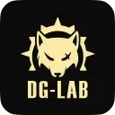

# DG-LAB Bluetooth Protocols

English | [简体中文](README_CN.md)

**DG-LAB** devices are enjoyed by users around the world. Many in our community want to integrate them into a wider range of creative, flexible, and personalized experiences.

This repository shares the Bluetooth protocols for selected DG-LAB devices. Use the language, framework, or approach of your choice to integrate these devices into your own projects.

> These protocols are published to give DG-LAB enthusiasts more freedom to use their devices. Commercial use of this content requires prior authorization. For commercial partnerships, [contact us](https://www.dungeon-lab.com). For technical questions, contact QQ [3849540080](tencent://message/?site=qq&menu=yes&uin=3849540080) (**questions about the published protocols and related development only**).

## Coyote Stimulator

- [Bluetooth Protocol V2](coyote/v2/README.md)
- [Bluetooth Protocol V3](coyote/v3/README.md)
- [Understanding Pulses](coyote/README.md)

## Pawprint Wireless Button Sensor

- [Bluetooth Protocol V1.1](paw-prints/README.md)
- [External Voltage Detection: Explanation and Examples](paw-prints/extvoltageinput/README.md)

## Civet Edging Sensor

- [Bluetooth Protocol V1](civet-edging-sensor/README.md)

## Opossum Vibration Controller

- [Bluetooth Protocol V1](opossum-vibrate-controller/README.md)

## Changelog

- 2026/10/16: Added English documentation.
- 2026/10/15: Corrected errors in the Civet, Coyote, and Pawprint protocol documentation and examples.
- 2026/06/11: Added the Pawprint V1.1 Bluetooth protocol and additional Opossum commands.
- 2026/06/09: Added the Opossum Vibration Controller Bluetooth protocol.
- 2026/06/04: Added the Civet Edging Sensor Bluetooth protocol.
- 2026/06/02: Improved the documentation and reorganized the repository.
- 2025/04/23: Corrected errors in the V3 Bluetooth protocol documentation.
- 2025/02/10: Added an explanation and examples for Pawprint external voltage detection.
- 2024/10/28: Added sample Pulse data for V2 and V3.
- 2024/04/25: Updated parts of the Pulse explanation.
- 2024/01/11: Updated the V3 protocol sections on channel intensity and Pulse output.

Documentation for V3 accessory interactions and how it will be shared is being revised.
