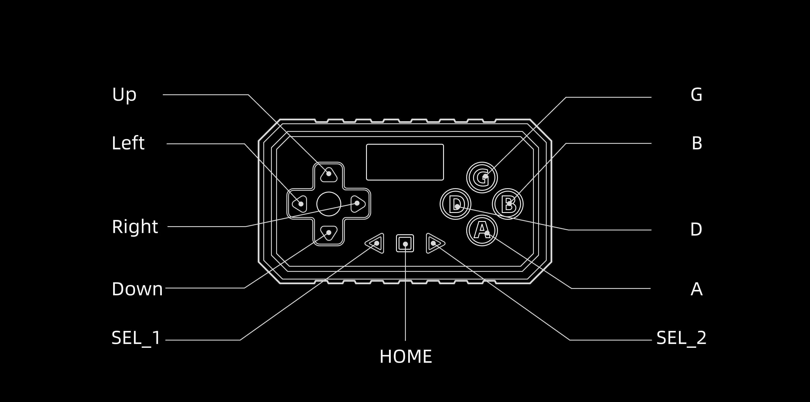

# Opossum Vibration Controller

[简体中文](README_CN.md)

## Bluetooth Characteristics

| Service UUID | Characteristic UUID | Properties | Name | Size | Description |
| --- | --- | --- | --- | --- | --- |
| 0x180C | 0x150A | Write | WRITE | Up to 20 bytes | All commands are written here |
| 0x180C | 0x150B | Notify | NOTIFY | Up to 20 bytes | All response messages are returned here |
| 0x180A | 0x1500 | Read / Notify | READ/NOTIFY | 1 byte | Battery level |

> Base UUID: `0000xxxx-0000-1000-8000-00805f9b34fb`. Replace `xxxx` with the service or characteristic UUID.

## Bluetooth Name

Opossum Vibration Controller: `47L127000`

> 1. If the powered-on device does not appear during discovery, press the power button five times in succession. The Bluetooth icon turns yellow when the device is discoverable.
> 2. On Android, an MTU of 144 is recommended after connecting.

## Bluetooth Commands

Write all Opossum commands to characteristic `0x150A` in service `0x180C`.

### 50 Command

The 50 command sets the main indicator color and enables or disables button press/release reports (3 bytes). Reports are received on `0x180C -> 0x150B`.

```
0x50 (1-byte command header) + 01 (1-byte indicator color) + 00/01 (1 byte: disable / enable button-state reporting)
```

### B0 Command

The B0 command writes vibration Pulse data for both channels in a single 20-byte command. Send it every 100 ms.

```
0xB0 (1-byte command header) + 00000000000000 (7 bytes of 00 padding) + xxxxxxxx (4-byte channel A vibration Pulse data) + 00000000 (4 bytes of 00 padding) + xxxxxxxx (4-byte channel B vibration Pulse data)
```

#### Channel A/B Vibration Pulse Data

The four bytes specify 100 ms of vibration Pulse intensity for the connected vibrator. Each byte represents 25 ms.

Valid intensity values are 0–100 (`0x00`–`0x64`). If any of the four bytes is out of range, all Pulse data for that channel in the B0 command is discarded.

### B3 Command

The B3 command sets the intensity of both channels in a single 3-byte command.

```
0xB3 (1-byte command header) + xx (1-byte channel A intensity) + xx (1-byte channel B intensity)
```

#### Channel A/B Intensity

Valid values are 0–200 (`0x00`–`0xC8`). Use `0xFF` to leave a channel unchanged.

```TypeScript
// Set channel A to 160; leave channel B unchanged.
0xB3A0FF
// Set channel B to 200; leave channel A unchanged.
0xB3FFC8
// Set channel A to 10 and channel B to 20.
0xB30A14
```

### B2 Command

The B2 command updates the channel intensity values shown on the display. While Opossum is connected to a host, the host must send these updates explicitly. Send B2 immediately after receiving a B3 message to keep the display in sync.

```
0xB2 (1-byte command header) + FFFF00FFFFFFFFFFFFFFFFFFFFFFFFFFFFFFFF0809 (21 fixed bytes) + xx (1-byte channel A intensity, 0x00–0xC8) + xx (1-byte channel B intensity, 0x00–0xC8)
```

## Bluetooth Response Messages

All Opossum data is returned through notifications on `0x180C -> 0x150B`. Subscribe to this characteristic after connecting.

### B3 Message

Opossum reports channel intensity whenever either channel changes through a Bluetooth command or a physical button (3 bytes).

```
0xB3 (1-byte message header) + xx (1-byte channel A intensity) + xx (1-byte channel B intensity)
```

### D0 Message

Opossum reports the physical button states whenever a button is pressed or released (16 bytes).

```
0xD0 (1-byte message header) + xx (1-byte sequence number) + xxxx (2-byte button-state bitmask) + xxxxxxxxxxxxxxxxxxxxxxxx (12 bytes of other information)
```

#### Sequence Number

Increments with each report, wrapping from 255 to 0 (`0x00`–`0xFF`).

#### Button-State Bitmask

`0b0` means released / not pressed; `0b1` means pressed.

| Bit offset | +0 | +1 | +2 | +8 | +9 | +10 | +11 | +12 | +13 | +14 | +15 |
| --- | --- | --- | --- | --- | --- | --- | --- | --- | --- | --- | --- |
| Physical button | SEL_1 | SEL_2 | HOME | Up | Down | Left | Right | B | A | G | D |


